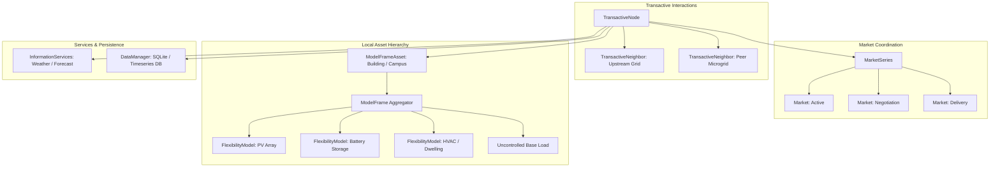
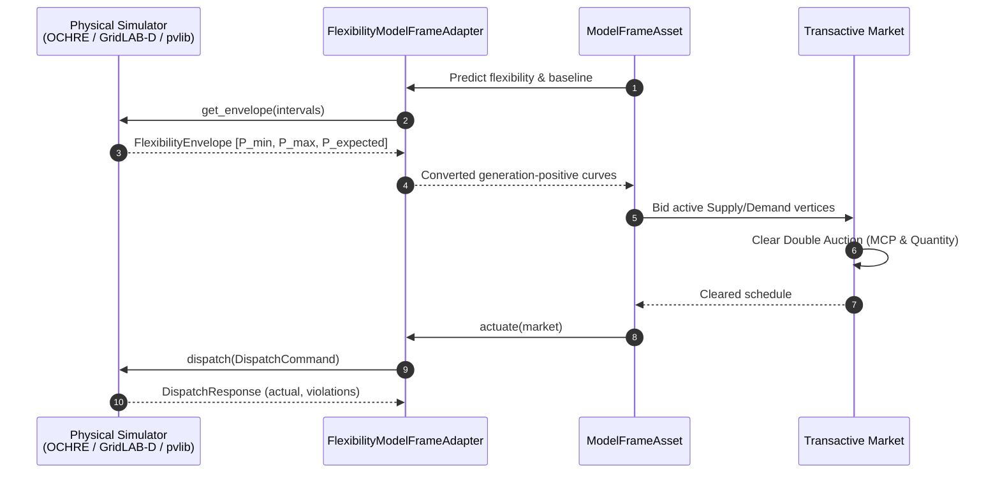
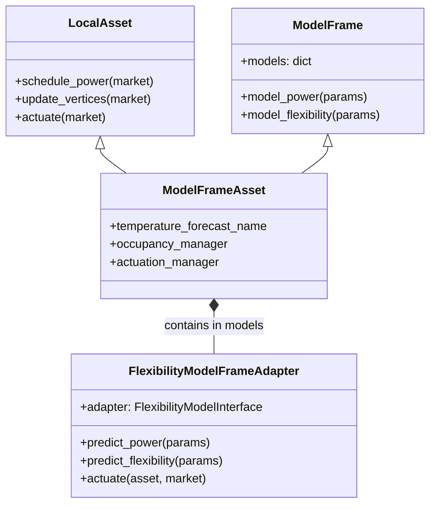
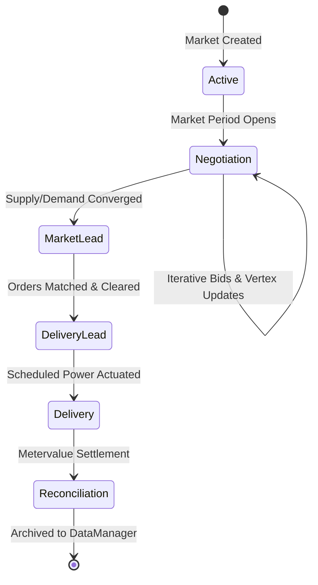

# Transactive Energy Network Template (TENT)

[](https://www.python.org/downloads/)
[](LICENSE)
[](tests/)

The **Transactive Energy Network Template (TENT)** is an object-oriented Python framework for modeling, simulating, and deploying transactive energy systems. TENT enables decentralized agents—representing commercial buildings, municipal grids, campus microgrids, and individual physical devices—to dynamically negotiate power schedules, balance supply and demand via market clearing, and actuate physical systems in real time.

---

## 📑 Table of Contents
- [Architecture Overview](#architecture-overview)
- [Core Components](#core-components)
- [Flexibility Modeling (`tent.flexibility`)](#flexibility-modeling-tentflexibility)
- [ModelFrameAsset & Asset Composition](#modelframeasset--asset-composition)
- [Market Lifecycle & Double Auctions](#market-lifecycle--double-auctions)
- [Installation & Quickstart](#installation--quickstart)
- [Running Simulations & CLI Examples](#running-simulations--cli-examples)
- [Testing](#testing)

---

## Architecture Overview

A **Transactive Node** represents an autonomous entity (e.g., a building, microgrid, or campus) participating in transactive electricity markets. It coordinates **Local Assets**, exchanges power with **Transactive Neighbors**, and clears energy orders across a series of **Markets**.



---

## Core Components

<details open>
<summary><b>1. Transactive Node (<code>TransactiveNode</code>)</b></summary>
<br>

The central orchestrator for a transactive entity. It maintains:
* **`local_assets`**: Internal devices and building systems that consume or produce energy.
* **`neighbors`**: External transactive partners with whom power is imported or exported.
* **`market_series`**: Active double auctions organized into rolling horizons.
* **`information_services`**: Forecast providers (e.g., outdoor air temperature, solar irradiance).
* **`data_manager`**: Relational and timeseries logging engine.

</details>

<details open>
<summary><b>2. Local Assets & ModelFrame (<code>ModelFrameAsset</code>)</b></summary>
<br>

Local assets represent controllable and uncontrollable energy resources. Rather than creating isolated, rigid device classes, TENT uses **`ModelFrameAsset`**—a composite asset model that aggregates one or more sub-models (`ModelFrame`):
* **Thermostat / HVAC Models**: Calculate heating/cooling demand curves.
* **Lighting Models**: Scheduled illumination loads.
* **Uncontrolled Models**: Inflexible base power loads.
* **FMI Flexibility Models**: Physical simulator adapters (OCHRE, GridLAB-D, pvlib, Replay).

</details>

<details open>
<summary><b>3. Markets & Double Auctions (<code>Market</code>, <code>Auction</code>)</b></summary>
<br>

TENT implements continuous double auctions where:
* Assets formulate **Supply / Demand Vertices** ($(P, Q)$ pairs) representing their willingness to shift power.
* The auction aggregates all buy and sell curves to determine the **Market Clearing Price (MCP)** and cleared power.
* Schedules are committed and dispatched to physical hardware or simulator adapters.

</details>

<details open>
<summary><b>4. Configuration: naming classes</b></summary>
<br>

A node is built from a JSON configuration. Every configurable slot (data manager, meter points, information services,
local assets, neighbors, market series and their market class and price model, model-frame models, occupancy and
actuation managers) names its class with `class_name`; the other keys of the block are the constructor's keywords.
`tent.registry` resolves the name:

1. With a `module_name` in the block, that module is imported and the class taken from it. This is how classes TENT
   does not ship are used; it works for shipped classes too.
2. Without one, the name is looked up among the classes TENT ships, registered by name in `tent.registry.SHIPPED`
   (for example `Neighbor`, `BulkSupplierDC`, `ModelFrameAsset`, `Thermostat`, `MarketSeries`, `Auction`,
   `ConsensusMarket`, `MatchingEngine`, `HourlyAveragePriceModel`, `LocalDataManager`).
3. Then among the `tent.components` entry points of installed packages. A package registers a class with
   `[project.entry-points."tent.components"] MyAsset = "my_package.assets:MyAsset"` and configurations can then name
   `MyAsset` without a `module_name`.

No module path is guessed from a class name. Whatever path produced the class, it must be a subclass of the base the
slot expects (`LocalAsset`, `Neighbor`, `Market`, `DataManager`, ...), or configuration fails with a `TypeError`. A
market series names its market class with `market_class_name` (and `market_module_name` for one from elsewhere) and
its price model in the `price_model` block; a model-frame asset names each model in `model_configs.models` by
`class_name` with the model's own keys in `model_config`. The configuration dictionaries are only read, so the same
ones can be given again to rebuild a node.

**The keys of a block are the fields of the class's `Config` model.** Every configurable class declares a nested
`Config` (Pydantic v2, on `tent.config.ConfigModel`); the constructor validates its keywords through it and reads its
settings from the validated instance, so `Neighbor.Config.model_fields` is the list of a neighbor's keys with their
types, bounds, defaults and descriptions (units in brackets), and `Neighbor.Config.model_json_schema()` the same as
JSON Schema. A subclass's model extends its parent's. The models encode TENT's conventions: durations are numbers of
seconds (read as `timedelta`), times of day are `"HH:MM"`, enumerations are given by member name, `cost_parameters` is
exactly three numbers or `null`, `default_vertices` is a list of `[price, cost, quantity, continuity, uncertainty]`
lists or dicts (`"inf"` for an infinite price), datetimes carry an offset (`simulation_start_time` without one is in
the node's `tz`), and other components are referred to by name. An unknown key is an error that names the component
and the key. `TransactiveNode.validate_configuration(configs)` checks a whole configuration before anything is built,
and `configure_node` does so first. Fields a running component may change in place (costs, limits, thresholds, default
prices, loss factors, demand rates, forecast sources, schedules) are marked `reconfigurable`; `component.reconfigure
(changes)` applies such a change and archives the new configuration version (table `component_configuration`), and
`TransactiveNode.reconfigure(new_config)` applies a whole new configuration in place when it differs only in such
fields (returning `True`) or returns `False` so the host rebuilds. `tent.registry.configuration_schema()` is the JSON
Schema (draft 2020-12) of a node configuration, every slot a `oneOf` over the registered classes, for editors and the
configuration tool. See `docs/source/design/configuration_models.rst`.

Between nodes, transactive signals travel in the wire format defined by `TransactiveSignalMessage`
(`tent/containers/transactive_signal_message.py`, protocol version 1.0): a Pydantic model that the sender serialises
through and the receiver validates before anything is looked up. An inelastic vertex's infinite price is `null` on the
wire; a message that does not fit is dropped with a logged reason.

</details>

---

## Flexibility Modeling (`tent.flexibility`)

<details open>
<summary><b>Click to expand / collapse: Flexibility Modeling, 3-Curve Envelopes & Simulators</b></summary>
<br>

To support arbitrary physical equipment (residential dwellings, batteries, commercial HVAC, water heaters, solar arrays, and distribution feeders), TENT embeds the **Flexibility Model Interface (FMI)**.

### The 3-Curve Flexibility Envelope

Rather than simple point forecasts, physical assets report a **3-Curve Envelope** over the scheduling horizon:
1. **$P_{\min}(t)$**: Minimum feasible power (maximum discharge / lowest consumption).
2. **$P_{\max}(t)$**: Maximum feasible power (maximum charging / highest consumption).
3. **$P_{\text{expected}}(t)$**: Baseline/uncontrolled operating trajectory.



### Sign Conventions (Load-Positive vs. Generation-Positive)

To prevent catastrophic sign errors, TENT establishes strict boundary conversions:

| Convention | Consumption / Load | Generation / Discharge | Used By |
| :--- | :--- | :--- | :--- |
| **`LOAD_POSITIVE`** (Canonical FMI) | $> 0$ (Positive) | $< 0$ (Negative) | Physical Simulators (`ochre`, `gridlabd`, `pvlib`, meters) |
| **`GENERATION_POSITIVE`** (TENT Internal) | $< 0$ (Negative) | $> 0$ (Positive) | TENT `ModelFrameAsset`, `Market`, `DoubleAuction` |

`FlexibilityModelFrameAdapter` transparently handles the conversion at the boundary:
$$\text{Power}_{\text{TENT}} = -\text{Power}_{\text{FMI}}$$

### Supported Simulator Adapters & Presets

TENT includes built-in adapters for major physical simulation tools:

1. **OCHRE (`tent.flexibility.adapters.ochre`)**:
   * Whole-house thermal simulation, heat pumps, water heaters, EV charging, and residential batteries.
   * Direct step-by-step state actuation in pure Python.

2. **GridLAB-D (`tent.flexibility.adapters.gridlabd`)**:
   * Distribution feeder simulation, substation transformer monitoring, multi-zone HVAC, and inverter control.

3. **pvlib (`tent.flexibility.adapters.pvlib`)**:
   * High-fidelity solar irradiance modeling, clear-sky models, cloudy weather interpolation, and inverter clipping.

4. **Replay Adapter (`tent.flexibility.adapters.replay`)**:
   * Deterministic replay of recorded CSV timeseries for offline test benches.

#### Available Presets:
```python
from tent.flexibility import load_adapter

# 1-line instantiation of pre-configured physical assets:
pv_adapter = load_adapter("residential_pv", rated_kw=8.0)
battery_adapter = load_adapter("residential_battery", capacity_kwh=13.5, max_power_kw=5.0)
wh_adapter = load_adapter("water_heater_50gal")
dwelling = load_adapter("dwelling_standard")
```

</details>

---

## ModelFrameAsset & Asset Composition

<details open>
<summary><b>Click to expand / collapse: ModelFrameAsset Architecture & JSON Configuration</b></summary>
<br>

TENT uses a composable architecture where a single transactive entity can combine any number of sub-models under one unified asset schedule.



### Example ModelFrameAsset JSON Configuration

Here is an example configuring a multi-resource building asset in `tn.campus.json`:

```json
{
  "class_name": "ModelFrameAsset",
  "name": "CampusSolarArray",
  "maximum_power": 120.0,
  "minimum_power": 0.0,
  "model_configs": {
    "demand_curve_points": 2,
    "models": [
      {
        "topic": "devices/campus_pv",
        "class_name": "FlexibilityModelFrameAdapter",
        "model_config": {
          "preset": "residential_pv",
          "resource_id": "campus_pv",
          "rated_kw": 120.0,
          "location": {
            "latitude": 46.28,
            "longitude": -119.28,
            "tz": "US/Pacific"
          },
          "system": {
            "surface_tilt": 30,
            "surface_azimuth": 180
          },
          "weather": {
            "kind": "clearsky",
            "cloud_factor": 1.0
          },
          "curtailable": false
        }
      }
    ]
  }
}
```

</details>

---

## Market Lifecycle & Double Auctions

<details open>
<summary><b>Click to expand / collapse: Market Lifecycle States & Double Auction Mechanics</b></summary>
<br>

TENT markets progress through deterministic lifecycle states to guarantee convergence and synchronization across nodes.



### Double Auction Market Clearing Mechanics

1. **Vertex Formulation**: Each asset transforms its flexibility envelope into a set of piecewise linear vertices $(P_i, Q_i)$.
2. **Curve Aggregation**: All supply curves are sorted in ascending order of price; demand curves in descending order.
3. **Intersection & Clearing**: The intersection defines the marginal clearing price:
   $$P_{\text{cleared}} = f(S_{\text{agg}}, D_{\text{agg}})$$
4. **Order Allocation**: Matched contracts are issued to counterparties and stored in the database.

</details>

---

## Installation & Quickstart

### Prerequisites
* Python 3.11 or newer
* `pip` in a virtual environment, [Poetry](https://python-poetry.org/), or [pixi](https://pixi.sh)

Dependencies are declared once, in `pyproject.toml` (PEP 621).

### 1. Clone and Install

```bash
git clone https://github.com/davidraker/TENT.git
cd TENT

# pip in a virtual environment (development install with the test suite)
python -m venv .venv
source .venv/bin/activate
pip install -e ".[dev]"

# or Poetry
poetry install --with dev

# or pixi, which also provisions the interpreter from conda-forge
pixi install
pixi run test            # whole suite; also test-unit and test-integration
```

### 2. Optional Physical Simulator Dependencies

The core package and the whole non-FMI test suite run without any simulator. To run physics-backed assets install the
matching extra; the FMI tests skip when a simulator is absent.

* **pvlib (solar physics)**: `pip install -e ".[pvlib]"`
* **OCHRE (residential buildings and batteries)**: `pip install -e ".[ochre]"`
* **Everything**: `pip install -e ".[flexibility]"`
* **GridLAB-D (distribution grid engine)**: install the GridLAB-D C++ engine and `pip install gridlabd` (see the
  [Sphinx documentation](docs/source/flexibility/installation_and_setup.rst) for full setup instructions).
* **Replay datasets**: no external simulator needed (built-in CSV time-series replay).

The Sphinx documentation needs the `docs` extra.

---

## Running Simulations & CLI Examples

TENT provides interactive CLI tools to simulate DERs, inspect 3-curve envelopes, and visualize transactive clearing directly in your terminal:

```bash
# Run standalone DER simulation with terminal graph visualization
python examples/run_der.py --preset residential_pv --horizon-hours 24

# Run with battery storage and dynamic price response
python examples/run_der.py --preset residential_battery --price-mean 0.08 --price-std 0.03
```

---

## Testing

TENT includes a comprehensive test suite covering schema contracts, simulator adapters, market mechanics, and closed-loop integration:

```bash
# Run the entire test suite
pytest

# Run flexibility interface and simulator adapter tests
pytest tests/fmi_tests/

# Run closed-loop ModelFrameAsset integration tests
pytest tests/integration_tests/test_fmi_modelframe.py tests/integration_tests/test_ochre_modelframe.py

# Run unit tests
pytest tests/unit_tests/
```

---

## License

This project is licensed under the BSD-3-Clause License. See [LICENSE](LICENSE) for details.
